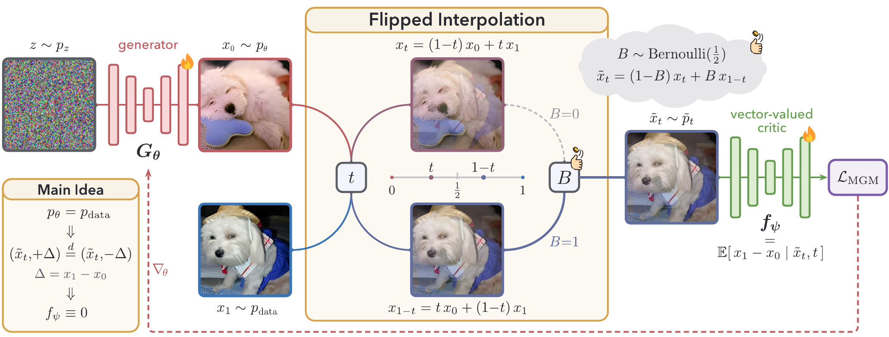
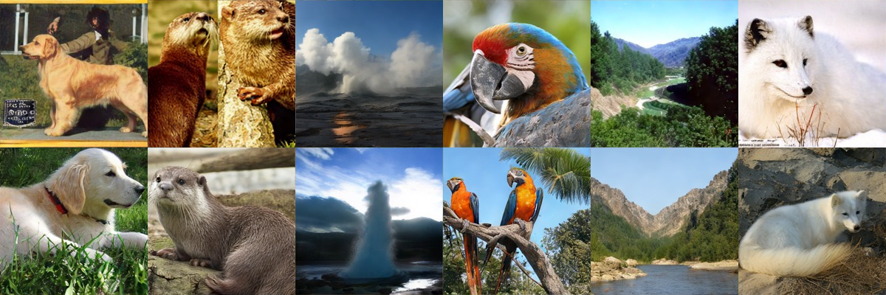

<h1 align="center">Midpoint Generative Models</h1>

<p align="center">
  We train a one-step generator using flow matching between its own samples and real data.
</p>

<p align="center">
  Daniil Shlenskii<sup>*</sup>, Nikita Gushchin<sup>*</sup>, Lev Novitskiy, Dmitry V. Dylov, Alexander Korotin<br>
  <sub>* Equal contribution</sub>
</p>

<p align="center">
  <a href="https://arxiv.org/abs/2605.29920">Paper (arXiv)</a> ·
  <a href="https://neurips.cc/virtual/2026/poster/154433">NeurIPS 2026</a>
</p>

<p align="center">
  
</p>

<p align="center">
  At the midpoint, the Flow Matching velocity vanishes exactly when the generated and real distributions match.
  A random time flip extends this symmetry to other interpolation times.
</p>

## Results

<p align="center">
  <br>
  <em>One-step samples on ImageNet 512×512.</em>
</p>

<p align="center">
  <strong>FID-50k ↓</strong> · CIFAR-10 <strong>2.27</strong> · ImageNet 64×64 <strong>2.50</strong> · ImageNet 512×512 <strong>2.36</strong>
</p>

## Quick Start

Install the environment from the repository root with `uv`. Training and sampling require Python 3.11–3.13 and CUDA.

```bash
uv sync
source .venv/bin/activate
```

### Train on CIFAR-10

Save the [CIFAR-10 Python archive](https://www.cs.toronto.edu/~kriz/cifar-10-python.tar.gz) to `downloads/cifar10/cifar-10-python.tar.gz`. The commands below prepare the dataset and start MGM training on two GPUs from NVIDIA’s pretrained EDM checkpoint.

```bash
python dataset_tool.py --source=downloads/cifar10/cifar-10-python.tar.gz \
    --dest=datasets/cifar10-32x32.zip

torchrun --standalone --nproc_per_node=2 train.py --preset=cifar10 \
    --data=datasets/cifar10-32x32.zip --outdir=runs/cifar10-edm \
    --checkpoint=https://nvlabs-fi-cdn.nvidia.com/edm/pretrained/edm-cifar10-32x32-uncond-vp.pkl
```

For the CIFAR-10 initialization used in the paper, see [CIFAR-10 denoising warmup](#cifar-10-denoising-warmup).

### Train on ImageNet

For [ImageNet 64×64](scripts/imagenet64.sh), set `IMAGENET_TRAIN` to the training image directory. For [ImageNet 512×512](scripts/imagenet512.sh), set `DATA` to the SD-VAE latent archive prepared with the [EDM2 dataset tool](https://github.com/NVlabs/edm2/blob/main/dataset_tool.py).

```bash
# ImageNet 64×64
IMAGENET_TRAIN=/path/to/imagenet/train bash scripts/imagenet64.sh

# ImageNet 512×512
DATA=/path/to/img512-sd.zip bash scripts/imagenet512.sh
```

### Generation

After training, generate 16 images from the final CIFAR-10 snapshot. The PNGs are saved to `out/cifar10/`.

```bash
python generate_onestep.py --network=runs/cifar10-edm/network-snapshot-020000.pkl \
    --outdir=out/cifar10 --seeds=0-15
```

## CIFAR-10 denoising warmup

For the reported FID-50k of 2.27, we initialized MGM from a DDPM++ denoiser trained on CIFAR-10 for 50,000 kimg. Run the warmup on the prepared dataset with eight GPUs:

```bash
torchrun --standalone --nproc_per_node=8 warmup_cifar.py \
    --data=datasets/cifar10-32x32.zip --outdir=runs/cifar10-warmup --duration-kimg=50000
```

Use the resulting snapshot as `--checkpoint=runs/cifar10-warmup/network-snapshot-050000.pkl` for MGM training. To run both stages with the paper settings, use [`bash scripts/cifar10.sh`](scripts/cifar10.sh).

## Training cost

| Preset | GPUs | Training time | Lowest FID reached at |
| --- | --- | --- | --- |
| `cifar10` | 2× H100 | ~2 days | ~19.5 Mimg (of 20) |
| `imagenet64` | 8× H100 | ~3 days | ~14.3 Mimg |
| `imagenet512` | 8× H100 | ~4 days | ~30.2 Mimg |

Times cover MGM training after initialization (Appendix C.1). On ImageNet 512×512, the paper run used TF32 and the release uses strict FP32, which takes longer. Appendix F includes the CIFAR-10 warmup in the full compute estimate.

## Citation

```bibtex
@inproceedings{shlenskii2026midpoint,
  title     = {Midpoint Generative Models},
  author    = {Shlenskii, Daniil and Gushchin, Nikita and Novitskiy, Lev and Dylov, Dmitry V. and Korotin, Alexander},
  booktitle = {Advances in Neural Information Processing Systems},
  year      = {2026},
  eprint    = {2605.29920},
  archivePrefix = {arXiv}
}
```

## Licenses

See [THIRD_PARTY_LICENSES.md](THIRD_PARTY_LICENSES.md). The root [LICENSE.txt](LICENSE.txt) applies to Apache-2.0 components; the NVIDIA-derived EDM/EDM2 components keep their CC BY-NC-SA 4.0 terms.
